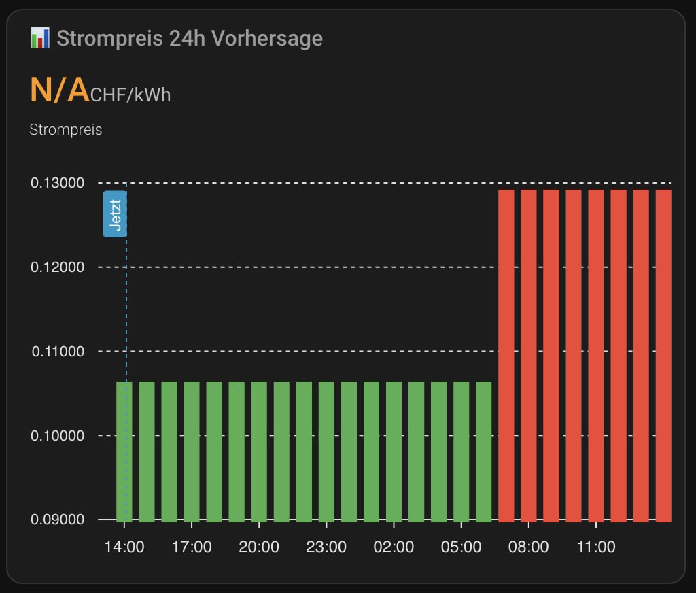

# SEC Energy Swiss Tariffs - Home Assistant Integration

[](https://github.com/custom-components/hacs)
[](https://opensource.org/licenses/MIT)

Home Assistant Integration für schweizer Stromtarife im SEC-Energy JSON-Format. Unterstützt dynamische Tarifauswahl, Echtzeit-Preise und 24h-Vorhersage.



## Features

- 🔌 **Mehrere Stromversorger** - Unterstützt alle SEC-Energy-kompatiblen APIs
- 📊 **Dynamische Tarifauswahl** - Tarife werden live von der API geladen
- ⚡ **Aktueller Preis** - Echtzeit-Strompreis basierend auf Tageszeit
- 📈 **24h Vorhersage** - Visualisiere die Preise für die nächsten 24 Stunden
- 💰 **Kostenberechnung** - Verbrauch × Preis = Kosten
- 🔄 **Automatischer Tarif-Wechsel** - Hochtarif/Niedertarif automatisch erkannt

## Unterstützte Anbieter (93+ Schweizer Stromversorger)

Die Integration unterstützt alle SEC-Energy-kompatiblen APIs. Hier eine Auswahl:

| Anbieter | Region |
|----------|--------|
| AEW | Aargau |
| Arbon Energie AG | Thurgau |
| ACA Airolo | Ticino |
| SH POWER | Schaffhausen |
| Commune de Paudex | Vaud |
| Comune di Stabio | Ticino |
| EGH Hünenberg | Zug |
| Technische Betriebe Birmenstorf | Aargau |
| Elektrizitätswerk Muhen | Aargau |
| Elektrizitätsversorgung Villigen (EVV) | Aargau |
| Elektrizitäts- und Wasserwerk Windisch | Aargau |
| Elektrizitätsversorgung Zeihen (EVZ) | Aargau |
| Elektra Genossenschaft Arni-Islisberg | Aargau |
| Elektra Horn AG | Thurgau |
| Elektra-Korporation Wolfhalden EKW | Appenzell |
| Elektra Mettauertal | Aargau |
| Elektra Remetschwil | Aargau |
| Elektrizitätsgenossenschaft Mellingen | Aargau |
| Elektrizitäts-Genossenschaft Merenschwand | Aargau |
| Elektra Aristau | Aargau |
| Elektra Beinwil | Aargau |
| Elektrizitätswerk Hefenhofen | Thurgau |
| Elektra Hermetschwil | Aargau |
| Elektrizitätsgenossenschaft Jonen | Aargau |
| Elektrizitätsgenossenschaft Mühlau | Aargau |
| Elektrizitätsgenossenschaft Otelfingen (EGO) | Zürich |
| Elektrizitätsgenossenschaft Rümikon | Zürich |
| Elektra Oberrohrdorf (EOR) | Aargau |
| IB Wohlen AG | Aargau |
| Stadtwerke Schaffhausen (SGSW) | Schaffhausen |
| Stadtwerke Wetzikon | Zürich |
| **+ 60 weitere Anbieter** | **Schweizweit** |
| Custom / Other | Beliebige SEC-Energy-kompatible URL |

## Tarifjahr-Wechsel

Vordefinierte Anbieter mit einer Jahreszahl in der URL nutzen einheitlich eine
**Jahres-Map** mit Ganzzahl-Schlüsseln, beispielsweise
`{2026: "https://www.tbflawil.ch/tarifkommunikation/2026_tariffs.json", ...}`.
Jahreslose Quellen und eigene URLs bleiben feste Strings.

Die Auflösung prüft zuerst den exakten Jahreseintrag. Fehlt er, wird im jüngsten
Map-Eintrag dessen Jahreszahl durch das gesuchte Jahr ersetzt. Danach folgen
ab Oktober das Folgejahr und anschließend das Vorjahr als Grace. Jeder Kandidat
muss das Schema und die Gültigkeitsprüfung bestehen; heute gültige Tarife haben
Vorrang vor einem nur für das Folgejahr gültigen Dokument. Publikations-Datestamps
lassen sich nicht zuverlässig erraten: recherchierte Folgejahres-URLs gehören in
die Jahres-Map. Bei vollständigem Fehlschlag bleiben Cache und letzter bekannter
Preis erhalten, mit `data_expired` und einem Repair-Hinweis statt stillschweigend
veralteter Preise. Folgejahresdaten ersetzen niemals vorzeitig heutige Preise.

Die Migration v1 → v2 speichert die Anbieteridentität (`dso_key`) und liest damit
bei jedem Abruf die aktuelle Jahres-Map aus dem Katalog; sie friert keine Kopie
der Map im Config Entry ein. Nicht zuordenbare eigene URLs bleiben unverändert.

## Installation

### Vor einem Upgrade: vollständiges Backup erstellen

> [!WARNING]
> **Ein Versionswechsel in HACS setzt keine gespeicherten Daten zurück.**
> Vor jedem Upgrade einer bestehenden Installation – insbesondere vor einer Beta –
> ein vollständiges Home-Assistant-Backup erstellen und eine Kopie außerhalb des
> HA-Systems sichern. Es muss den bisherigen Integrationscode unter
> `custom_components/sec_energy`, die Konfiguration und den gesamten zugehörigen
> `.storage`-Inhalt enthalten. Bei verschlüsselten Backups den zur Wiederherstellung
> nötigen Schlüssel separat sicher aufbewahren. Ohne ein wiederherstellbares
> Vor-Upgrade-Backup gibt es keinen zugesicherten Rückweg.

**Config-Flow-Migration V1 → V2:** Der Release `v1.1.0` verwendet
Config-Entry-Version 1. Der neuere Entwicklungsstand auf `main` verwendet Version 2:
Beim Laden bestehender Einträge migriert `async_migrate_entry` diese dauerhaft und
speichert zusätzlich `dso_key`, `resolved_url` und `valid_until`. Außerdem legt die
Integration einen Tarif-Cache unter `.storage/sec_energy.<entry_id>.tariffs` an.
**V1/V2 bezeichnet hier das Konfigurationsformat, nicht die Release-Version.**

Für diese Config-Entry-/Storage-Änderungen gibt es **keine unterstützte
Rückwärtsmigration**. Ein bloßer Dateidowngrade auf `v1.1.0` ist daher kein
unterstützter Rollback. Auch das Abschalten von Beta-Updates macht die Migration
nicht rückgängig. `.storage` nicht manuell bearbeiten und die Config-Entry-Version
nicht zurücksetzen.

Falls ein Rückweg nötig ist, das vollständige **Backup von vor dem Upgrade**
wiederherstellen: Integrationscode, Konfiguration und Storage müssen zusammen den
alten, konsistenten Stand ergeben. Änderungen seit diesem Backup gehen dabei
verloren. Ein direkter Wechsel auf eine spätere Stable-Version ist nur dann ein
zugesicherter Rückweg, wenn deren Config-Entry- und Storage-Kompatibilität für den
konkreten Versionswechsel getestet und dokumentiert ist.

### HACS (empfohlen)

1. HACS in der Home-Assistant-Seitenleiste öffnen.
2. Im HACS-Menü **⋮ → Benutzerdefinierte Repositories** öffnen.
3. URL `https://github.com/marcelloceschia/ha-ch-energy` mit Kategorie
   **Integration** hinzufügen.
4. Das Repository **SEC Energy Swiss Tariffs** öffnen und den aktuellen
   **Stable-Release** herunterladen. Für eine bestimmte Version siehe unten.
5. Home Assistant neu starten; danach die Integration unter
   **Einstellungen → Geräte & Dienste** hinzufügen bzw. die bestehende prüfen.

### Manuell

1. Einen veröffentlichten [Release](https://github.com/marcelloceschia/ha-ch-energy/releases)
   auswählen und dessen Quellcode herunterladen, nicht einen beliebigen `main`-Stand.
2. Den Ordner `custom_components/sec_energy` aus diesem Release vollständig nach
   `<config>/custom_components/sec_energy` kopieren; keine Dateien verschiedener
   Versionen mischen. Bei einem Upgrade zuerst das oben beschriebene Backup erstellen.
3. Home Assistant neu starten.

## Versionen: Stable und Beta

- **Stable** ist die Standardwahl für den produktiven Betrieb.
- **Beta** ist eine ausdrücklich gewählte Vorabversion für Tests und kann Fehler
  sowie dauerhafte Datenänderungen enthalten. Betas tragen das Schema
  `vX.Y.Z-beta.N` und sind auf GitHub als **Pre-release** markiert; das Schema ist
  kein Hinweis darauf, dass bereits eine Beta veröffentlicht wurde.
- Stable und Beta sind alternative Versionen **derselben Integration** (`sec_energy`),
  keine parallel installierbaren Integrationen. Es gibt keinen Versionsschalter im
  SEC-Energy-Konfigurationsdialog.

### Eine bestimmte Version mit HACS auswählen

Die Auswahl erfolgt im **HACS-Repository**, nicht auf der normalen HA-Updatekarte:

1. HACS in der Seitenleiste öffnen und das Repository auswählen.
2. **⋮ → Redownload → Need a different version?** öffnen.
3. Unter **Release** die gewünschte veröffentlichte Version auswählen.
4. Mit **Download** herunterladen und Home Assistant neu starten.
5. Die heruntergeladene Version in HACS und bei Bedarf den `version`-Wert in
   `<config>/custom_components/sec_energy/manifest.json` prüfen; anschließend
   Integration und Protokoll auf Fehler prüfen.

Die Beschriftungen können je nach HACS-Version und Sprache abweichen. Siehe die
[HACS-Anleitung zur Versionsauswahl](https://www.hacs.xyz/docs/use/repositories/dashboard/#downloading-a-specific-version-of-a-repository).
Die Liste kann veröffentlichte Stable- und Pre-releases enthalten; eine Beta wird
bewusst über ihren Release-Namen gewählt, nicht über eine zusätzliche Checkbox im
Redownload-Dialog. Fehlt die gewünschte Version, im Repository-Menü zunächst
**Update information** ausführen. Nicht veröffentlichte Versionen erscheinen nicht
in der Release-Liste. Stand 31.10.2026 ist nur `v1.1.0` veröffentlicht, keine Beta.

### Beta-Auswahl und spätere Updates

Die einmalige Auswahl einer Beta im Redownload-Dialog und der laufende
Pre-release-Updatekanal sind getrennte HACS-Funktionen. HACS stellt dafür eine
eigene **Pre-release-Schalter-Entität** bereit; deren genaue Bezeichnung und
Bedienung hängen von der installierten HACS-Version ab. Die Entität kann zunächst
in der Entitätsverwaltung deaktiviert sein und muss dann dort erst aktiviert
werden. Ohne ausdrückliches Opt-in ist dieser Kanal standardmäßig ausgeschaltet.
Wer weitere Beta-Updates möchte, muss den HACS-Pre-release-Kanal bewusst einschalten.

Zum Beenden der Beta-Updates diesen Kanal deaktivieren. Das installiert weder
automatisch Stable noch ältere Daten. Vor einem Wechsel auf Stable zuerst die
[Backup- und Rollback-Warnung](#vor-einem-upgrade-vollständiges-backup-erstellen)
beachten; ein niedrigerer Release in der HACS-Liste ist keine Zusage für einen
sicheren Downgrade.

## Konfiguration

### Schritt 1: Integration hinzufügen

1. Einstellungen → Geräte & Dienste → Integration hinzufügen
2. "SEC Energy Swiss Tariffs" suchen

### Schritt 2: Stromversorger wählen

Wähle deinen Stromversorger aus der Liste oder gib eine eigene API-URL ein.

### Schritt 3: Tarif auswählen

Alle verfügbaren Tarife werden dynamisch von der API geladen. Wähle deinen Tarif (z.B. "S-Standard", "S-100 T", etc.).

## Erstellte Entitäten

### Haupt-Sensoren (mit DSO-Namen)

| Entität | Beschreibung |
|---------|-------------|
| `sensor.{dso_name}_aktueller_preis` | Aktueller Strompreis (CHF/kWh) |
| `sensor.{dso_name}_preisvorhersage` | Preisvorhersage 24h (Attribute: `forecast`) |
| `sensor.{dso_name}_grundgebuehr` | Monatliche Grundgebühr (CHF) |

**Hinweis:** `{dso_name}` wird während der Einrichtung festgelegt (z.B. `stadtwerke_wetzikon`).

### Alias Template-Sensoren (optional)

Kopiere [`templates/sec_energy_aliases.yaml`](templates/sec_energy_aliases.yaml) in deine Home Assistant Konfiguration und passe den DSO-Namen an:

```yaml
# In configuration.yaml:
template: !include templates/sec_energy_aliases.yaml
```

Dies erstellt folgende kurze Entitätsnamen:

| Entität | Beschreibung |
|---------|-------------|
| `sensor.strompreis_aktuell` | Aktueller Strompreis |
| `sensor.strompreis_forecast` | 24h Vorhersage (Attribut: `forecast`) |
| `sensor.strompreis_grundgebuehr` | Grundgebühr/Monat |
| `sensor.strompreis_ist_hochtarif` | `true`/`false` |
| `sensor.strompreis_naechste_stunde` | Preis nächste Stunde |
| `sensor.strompreis_tiefster_heute` | Tiefster Preis heute |
| `sensor.strompreis_hoechster_heute` | Höchster Preis heute |
| `sensor.strompreis_durchschnitt_heute` | Durchschnittspreis heute |
| `sensor.strompreis_kostenvoranschlag_heute` | Geschätzte Kosten heute |

## Dashboard-Karten

### Preisvorhersage mit ApexCharts

```yaml
type: custom:apexcharts-card
header:
  show: true
  title: 📊 Strompreis 24h Vorhersage
  show_states: true
  colorize_states: true
graph_span: 24h
span:
  start: minute
  offset: "-30m"
now:
  show: true
  label: Jetzt
series:
  - entity: sensor.strompreis_forecast
    name: Strompreis
    type: column
    data_generator: |
      const forecast = entity.attributes.forecast;
      const colorMap = {
        'cheap': '#4CAF50',
        'normal': '#FFC107',
        'expensive': '#FF9800',
        'peak': '#F44336'
      };
      if (!forecast) return [];
      return forecast.map(item => {
        return {
          x: new Date(item.hour).getTime(),
          y: item.price,
          fillColor: colorMap[item.category] || '#9E9E9E'
        };
      });
    float_precision: 4
yaxis:
  - min: 0.09
    max: 0.13
    decimals: 5
apex_config:
  chart:
    toolbar:
      show: false
    animations:
      enabled: true
  legend:
    show: false
  tooltip:
    "y":
      formatter: |
        function(val, { seriesIndex, dataPointIndex, w }) {
          const forecast = w.config.series[seriesIndex].data[dataPointIndex];
          const item = entity.attributes.forecast[dataPointIndex];
          return val + ' CHF/kWh (' + item.category_label + ')';
        }
```

### Übersichtskarte

```yaml
type: entities
title: ⚡ Strompreis Übersicht
entities:
  - sensor.strompreis_aktuell
  - sensor.strompreis_ist_hochtarif
  - sensor.strompreis_naechste_stunde
  - sensor.strompreis_tiefster_heute
  - sensor.strompreis_hoechster_heute
  - sensor.strompreis_grundgebuehr
```

## Automatisierungen

### Waschmaschine nur bei Niedertarif starten

```yaml
automation:
  - alias: "Waschmaschine bei Niedertarif starten"
    trigger:
      - platform: state
        entity_id: sensor.strompreis_ist_hochtarif
        to: "false"
    condition:
      - condition: state
        entity_id: input_boolean.waschmaschine_bereit
        state: "on"
    action:
      - service: switch.turn_on
        target:
          entity_id: switch.waschmaschine
```

## Tarif-Struktur (S-Standard Beispiel)

| Zeitraum | Preis (CHF/kWh) |
|----------|----------------|
| Nacht (Mo–Sa 00:00–07:00) | 0.1064 |
| Hochtarif (Mo–Fr 07:00–20:00) | 0.1292 |
| Abend (Mo–Fr 20:00–00:00) | 0.1064 |
| Samstag 07:00–13:00 | 0.1292 |
| Samstag 13:00–00:00 | 0.1064 |
| Sonntag ganztags | 0.1064 |
| **Grundgebühr** | **9 CHF/Monat** |

## API-Format

Die Integration erwartet Daten im SEC-Energy JSON-Format:

```json
{
  "dsoName": "Stadtwerke Wetzikon",
  "tariffs": [
    {
      "tariffName": "S-Standard",
      "tariffType": "grid",
      "tariffForm": "multilevel",
      "prices": {
        "base": {"price": 9, "priceUnit": "CHF/M"},
        "energy": [
          {"months": ["Jan", ...], "weekdays": ["Mo", ...], "from": "00:00", "to": "07:00", "price": 0.1064, "priceUnit": "CHF/kWh"}
        ]
      }
    }
  ]
}
```

## Mitwirken

1. Fork erstellen
2. Feature-Branch: `git checkout -b feature/neues-feature`
3. Commit: `git commit -am 'Neues Feature'`
4. Push: `git push origin feature/neues-feature`
5. Pull Request erstellen

## Lizenz

MIT License - siehe [LICENSE](LICENSE)

## Danksagung

- [SEC Energy](https://sec-energy.ch/) für die standardisierte Tarifdaten-API
- [Home Assistant](https://www.home-assistant.io/) Community
